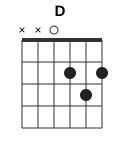

# Abuelito Fuego

| | |
|---|---|
| Темп | ~136 BPM |
| Тональность (звучит) | Am |
| Каподастр | нет (подобран по звуку под открытые аккорды) |
| Длительность | 0:54 |

## Аккорды

Формы указаны с учётом каподастра — так, как их держит левая рука.

   

| Аккорд | Лады (6→1) | Сколько звучит |
|---|---|---|
| **Am** | `x02210` | 34 с |
| **G** | `320003` | 11 с |
| **D** | `xx0232` | 3 с |
| **Dm** | `xx0231` | 2 с |

## Последовательность

Основной квадрат (×5): **| Am | Am | Am | Am |**

По тактам (4/4, в строке 4 такта):

```
 0:00  | Am      | Am      | Am      | Am      |
 0:07  | Am      | Am      | Am      | Am G    |
 0:14  | G       | Am      | Am      | Am      |
 0:21  | Am      | Am G    | G       | Am      |
 0:28  | Am D    | D       | Am      | Am G    |
 0:35  | G       | Am      | Am Dm   | Dm      |
 0:41  | Am      | Am G    | G       | G Am    |
 0:48  | Am —    | —       | —       |
```

## Бой

Запись: **Д- Д- Д- Д-** (Д — вниз, В — вверх, «-» — рука проходит мимо струн)

```
Счёт:   1  и  2  и  3  и  4  и
Бой:    ↓  ·  ↓  ·  ↓  ·  ↓  ·
Акцент: >     >     >     >
```

Этот рисунок совпал в 2 из 29 тактов.

Рука двигается как маятник без остановок: вниз на счёт, вверх на «и». Там, где точка, рука всё равно делает движение, просто не задевает струны.

## Текст с аккордами

Аккорд стоит над словом, на котором его нужно сменить. Слева время в ролике. Текст распознан автоматически: в редких словах возможны ошибки.

```
       Am
 0:00  1, 2, 3, 1, 2, 3, 1, 2, 3, 1, 2

       Am
 0:06  (поют 10 с, слова не разобраны)

       Am
 0:18  (поют 8 с, слова не разобраны)

       Am
 0:29  (поют 18 с, слова не разобраны)

       
 0:51  buena práctica

```

## Слух против зрения

Видеоанализ не запускался (нет `ANTHROPIC_API_KEY` или видео). Аккорды и бой — только по звуку.

## Как выучить

1. Поставьте аккорды Am, G, D, Dm и переставляйте их по кругу без ритма, пока смена не станет занимать меньше доли.
2. Бой «Д- Д- Д- Д-» сначала на одном заглушённом аккорде, под метроном 95 BPM.
3. Соедините: квадрат + бой на медленном темпе, затем поднимайте до 136 BPM.
4. Играйте вместе с видео — на сменах частей слушайте, где бой меняется.

---
_Разбор собран автоматически: звук — librosa (хрома + Витерби, онсеты), видео — Claude (формы аккордов, каподастр) и OpenCV (движение правой руки). Проверяйте на слух, особенно редкие аккорды._