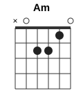
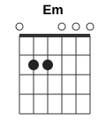
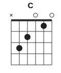
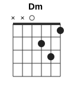
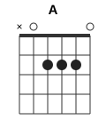
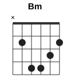

# Abuelito Fuego

| | |
|---|---|
| Темп | ~74 BPM |
| Тональность (звучит) | Cm |
| Каподастр | 3-й лад (подобран по звуку под открытые аккорды) |
| Длительность | 1:21 |

## Аккорды

Формы указаны с учётом каподастра — так, как их держит левая рука.

      

| Аккорд | Лады (6→1) | Сколько звучит |
|---|---|---|
| **Am** | `x02210` | 32 с |
| **Em** | `022000` | 17 с |
| **C** | `x32010` | 10 с |
| **Dm** | `xx0231` | 7 с |
| **A** | `x02220` | 7 с |
| **D** | `xx0232` | 2 с |
| **Bm** | `x24432`, баррэ на 2-м | 2 с |

## Последовательность

Основной квадрат (×2): **| Am | Am Em | Am | Am |**

По тактам (4/4, в строке 4 такта):

```
 0:02  | Am      | Am Em   | Am      | Am      |
 0:14  | Am Em   | Am Dm   | Dm C    | C Bm    |
 0:27  | A Dm    | Dm C    | C Em    | Am      |
 0:40  | Am      | Am Em   | Am      | Am      |
 0:53  | Am Em   | A D     | D C     | C Em    |
 1:06  | A Dm    | Dm C    | C Em    | Am —    |
```

## Бой

Запись: **ДВ ДВ ДВ ДВ** (Д — вниз, В — вверх, «-» — рука проходит мимо струн)

```
Счёт:   1  и  2  и  3  и  4  и
Бой:    ↓  ↑  ↓  ↑  ↓  ↑  ↓  ↑
Акцент: >  >  >     >     >  >
```

Этот рисунок совпал в 2 из 24 тактов.

Рука двигается как маятник без остановок: вниз на счёт, вверх на «и». Там, где точка, рука всё равно делает движение, просто не задевает струны.

## Текст с аккордами

Аккорд стоит над словом, на котором его нужно сменить. Слева время в ролике. Текст распознан автоматически: в редких словах возможны ошибки.

```
       Am
 0:39  (поют 8 с, слова не разобраны)

       Am
 0:49  (поют 8 с, слова не разобраны)

       A   D                  C            Em
 0:59  Por abrir el corazón a la sanación, abrir el amor.

       Dm
 1:09  (поют 8 с, слова не разобраны)

```

## Слух против зрения

Видеоанализ не запускался (нет `ANTHROPIC_API_KEY` или видео). Аккорды и бой — только по звуку.

## Как выучить

1. Поставьте аккорды Am, Em, C, Dm и переставляйте их по кругу без ритма, пока смена не станет занимать меньше доли.
2. Бой «ДВ ДВ ДВ ДВ» сначала на одном заглушённом аккорде, под метроном 51 BPM.
3. Соедините: квадрат + бой на медленном темпе, затем поднимайте до 74 BPM.
4. Играйте вместе с видео — на сменах частей слушайте, где бой меняется.

---
_Разбор собран автоматически: звук — librosa (хрома + Витерби, онсеты), видео — Claude (формы аккордов, каподастр) и OpenCV (движение правой руки). Проверяйте на слух, особенно редкие аккорды._