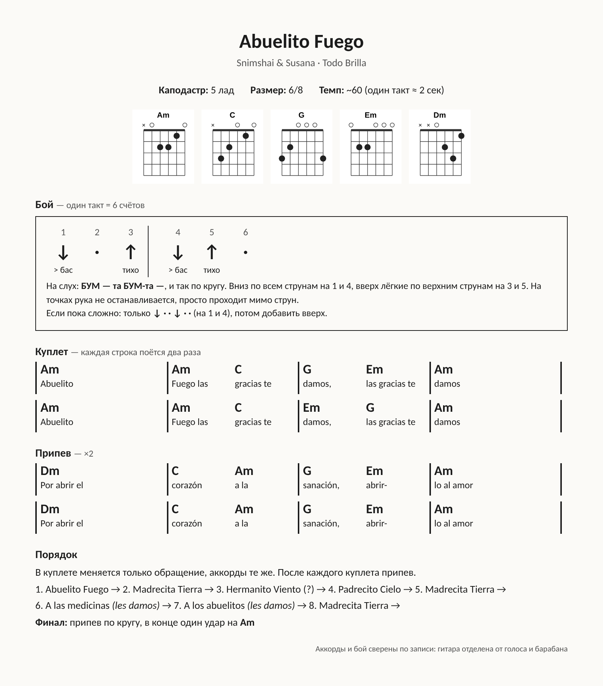

# Abuelito Fuego

Snimshai & Susana, альбом «Todo Brilla».



| | |
|---|---|
| Каподастр | **5-й лад** (звучит в ре миноре) |
| Аккорды | Am, C, G, Em, Dm |
| Размер | **6/8**: в такте 6 счётов, сильные доли на 1 и 4 |
| Темп | ~60 ударов на такт-половину, один такт ≈ 2 секунды |
| Длительность | 6:43 |

## Бой

```
Счёт:  1   2   3 │ 4   5   6
Бой:   ↓   ·   ↑ │ ↓   ↑   ·
       бас     тихо бас тихо
```

На слух: «БУМ — та БУМ-та —». Вниз по всем струнам на 1 и 4, лёгкие удары вверх по верхним струнам на 3 и 5. На точках рука проходит мимо струн.

Как определён: гитара отделена от голоса и барабана (Demucs), удары разложены по сетке восьмых. Рисунок повторяется каждые 6 восьмых всю песню. Сильнее всего звучат 1 и 4, на них же басовые струны. На 3 и 5 удары тише и без баса, это удары вверх. На 2 и 6 почти тишина. Барабан в записи бьёт на 1 и глухо на 4.

Упрощённый вариант: только ↓ на 1 и 4.

## Аккорды по тактам

Куплет (каждая строка ×2, во второй раз Em и G меняются местами):

```
| Am            | Am      C      | G       Em     | Am            |
  Abuelito        Fuego las       damos, las       damos
                          gracias te      gracias te
```

Припев ×2:

```
| Dm            | C       Am     | G       Em     | Am            |
  Por abrir el    corazón a la     sanación, abrir- lo al amor
```

## Порядок куплетов

1. Abuelito Fuego
2. Madrecita Tierra
3. Hermanito Viento (распознано неуверенно)
4. Padrecito Cielo
5. Madrecita Tierra
6. A las medicinas (las gracias **les** damos)
7. A los abuelitos (las gracias **les** damos)
8. Madrecita Tierra
9. Финал: припев по кругу, последний удар на Am

После каждого куплета припев.

Файлы: `sheet.html` / `sheet.png` — лист в стиле распечатки, `guitar.ogg` и `vocals.ogg` — гитара и голос отдельно, `analysis.json` — сырой автоанализ (он ошибочно считал размер 4/4).
