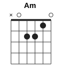
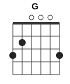
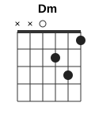
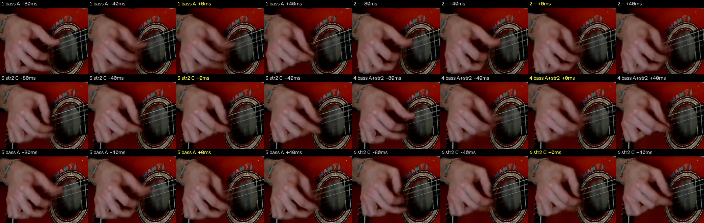
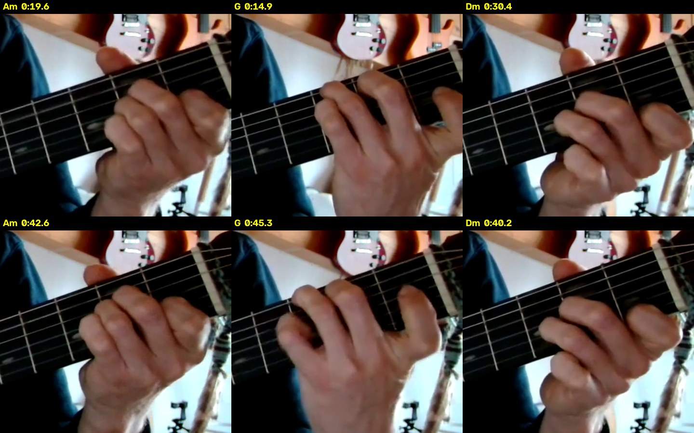

# Abuelito Fuego: разбор для гитары

Видео: Micelio Sonoro, «Abuelito fuego» (exercise). Классическая гитара, поёт сам гитарист, 0:55. В начале он считает вслух «uno, dos, tres», в конце говорит «buena práctica».

Разбор сделан по отдельным нотам, а не только по аккордам: каждая нота снята с чистой гитары (голос отделён нейросетью Demucs), привязана к струне и сверена с видео. На видео отслеживаются суставы пальцев обеих рук. Полная табулатура по тактам — в [README.md](README.md), каждая нота с временем, струной, ладом и пальцем — в [notes.csv](notes.csv), все ноты для MuseScore/Guitar Pro — в [guitar-notes.mid](guitar-notes.mid).

## Коротко

| | |
|---|---|
| Каподастр | **нет** |
| Аккорды | **Am, G, Dm**. Три открытых аккорда, баррэ нет |
| Размер | **на шесть**: «раз-два-три, раз-два-три», один аккорд на такт |
| Правая рука | **перебор** p-i-m: бас большим на «1» и «4», 2-я струна средним на «3» и «6», 3-я указательным на «и» |
| Темп | ~137 счётов в минуту (такт около 2,6 с) |
| Форма | `Am Am G Am` ×2 → `Dm Am G Am` ×2 |

## Аккорды

  

| Аккорд | Лады (6→1) | Бас (большой палец) |
|---|---|---|
| **Am** | `x02210` | 5-я струна, открытая |
| **G** | `320003` | 6-я струна, 3-й лад |
| **Dm** | `xx0231` | 4-я струна, открытая |

Самая трудная смена — **Dm → Am**: указательный остаётся на 1-м ладу, но переезжает с 1-й струны на 2-ю. Остальные пальцы переставляются целиком.

## Форма песни

```
Вступление:  | Am | Am | Am |            «uno, dos, tres» и первый перебор
Часть А:     | Am | Am | G  | Am |  ×2   «Abuelito fuego…»
Часть Б:     | Dm | Am | G  | Am |  ×2   «Por abrir el corazón…»
Концовка:    | Am | Am |                 «buena práctica»
```

| Время | Что |
|---|---|
| 0:00 | вступление на Am, счёт вслух |
| 0:08 | часть А, первый раз |
| 0:19 | часть А, второй раз |
| 0:29 | часть Б, первый раз |
| 0:39 | часть Б, второй раз |
| 0:47–0:55 | Am до конца |

## Перебор

Боя нет, всё играется пальцами. Двенадцать позиций в такте: шесть счётов и шесть «и». Фигура одна для всех аккордов:

- **«1» и «4»** — бас большим пальцем (p) и вместе с ним 2-я струна (щипок).
- **«3» и «6»** — 2-я струна средним пальцем (m).
- **«и» после 2, 3, 5** — 3-я струна указательным (i), тихо, заполняет промежутки.
- **«2»** — пусто, звучит то, что уже взято.

На слух: **БУМ — . ти ТИН ти БУМ — . ти ТИН ти**.

Табы на один такт. В таб попала нота, если она звучит на этой позиции хотя бы в половине тактов с этим аккордом. У Dm тактов всего два, поэтому там ноты, которые звучат в обоих.

```
Am  (14 тактов)
   1 и 2 и 3 и 4 и 5 и 6 и
e|-------------------------|
B|-1-------1---1-------1---|
G|-------2---2-------2---0-|
D|-------------------------|
A|-0-----------0-----------|
E|-------------------------|

G  (4 такта)
   1 и 2 и 3 и 4 и 5 и 6 и
e|-------------0-----------|
B|-0-------0---0-------0---|
G|---0---0-0-0-0-0---0---0-|
D|-------------------------|
A|-------------------------|
E|-3---3-------3-----------|

Dm  (2 такта)
   1 и 2 и 3 и 4 и 5 и 6 и
e|-------------1-------1---|
B|-3-------3---3-----3-3---|
G|-2-2---2-2-----2-------0-|
D|-0-----------0-----------|
A|-------------------------|
E|-------------------------|
```

Чем отличаются аккорды:
- **Am** — базовая фигура. На «6-и» звучит открытая 3-я струна: средний палец уже уходит со 2-го лада перед следующим тактом.
- **G** — бас соль на «1», «2» и «4». 3-я струна (открытая соль) звучит почти на каждой позиции, самая плотная фигура. На «4» вместо баса или вместе с ним звучит открытая 1-я струна, поэтому в G на 1-й струне ми, а не соль на 3-м ладу.
- **Dm** — на «1», «3», «4», «6» вместе звучат несколько струн (щипок), на «4» и «6» сверху добавляется 1-я.

Переходы. В начале такта Am после G иногда ещё звучит открытая 2-я струна (си): пальцы не успели переставиться. Это хвост прошлого аккорда, учить его не нужно.

Как разучить:
1. Am, медленно, считая «раз-и-два-и-три-и»: бас со 2-й струной на «раз», 3-я на «два-и», 2-я на «три», 3-я на «три-и». Метроном 60.
2. Вторая половина такта так же: «четыре» — бас со 2-й струной, 3-я на «пять-и», 2-я на «шесть».
3. G и Dm по табам, затем смены Am → G → Am и Dm → Am.
4. Поднимайте темп до 137 счётов в минуту.

**Какими пальцами играется каждая струна** — по видео, доля нот этой струны:

| Струна | большой (p) | указательный (i) | средний (m) | безымянный (a) | не видно |
|---|---|---|---|---|---|
| 5–6-я (бас) | 51% | 4% | 31% | 2% | 11% |
| 4-я | 31% | 19% | 12% | 6% | 31% |
| 3-я | 4% | **61%** | 24% | 2% | 8% |
| 2-я | 1% | 7% | **67%** | 19% | 5% |
| 1-я | 0% | 0% | 52% | 41% | 7% |

Картина классическая: бас — большой, 3-я — указательный, 2-я — средний, 1-я — средний или безымянный. Проценты не 100, потому что видео 25 кадров в секунду и кисть в кадре мелкая. Когда две ноты звучат одновременно, палец определяется хуже.

## Текст с аккордами

Аккорд стоит над словом, на котором его нужно сменить. Слева время в ролике. Последнее «damos» и «amor» поются ещё на G, Am приходит сразу после.

```
— ВСТУПЛЕНИЕ —
       Am                              Am     Am
0:00  Uno, dos, tres, uno, dos, tres … (перебор) …

— ЧАСТЬ А —
       Am                Am                     G                       Am
0:08  … Abuelito fuego, las gracias te damos,  las gracias te damos   …(тянем)

       Am                Am                     G                       Am
0:19  Abuelito fuego,   las gracias te damos,  las gracias te damos   …(тянем)

— ЧАСТЬ Б —
            Dm                Am               G                  Am
0:29  Por  abrir el corazón, a la sanación,  abrir el amor   …(тянем)

            Dm                Am               G                  Am
0:39  Por  abrir el corazón, a la sanación,  abrir el amor   …(тянем)

— КОНЦОВКА —
       Am            Am
0:47  (перебор) …   0:50  Buena práctica
```

Перевод: «Дедушка огонь, благодарим тебя. Чтобы открыть сердце исцелению, открыть любовь».

Слова распознаны автоматически (Whisper) по отделённому голосу. Все строки разборчивы, уверенность высокая.

## Как проверял

Каждый вывод проверен как минимум двумя независимыми способами.

| Что | Чем | Результат |
|---|---|---|
| Каподастр | кадры + звук | на кадрах виден верхний порожек, каподастра нет. По звуку все аккорды в открытых формах без него |
| Ноты | Basic Pitch (нейросеть Spotify, многоголосая транскрипция) → фильтр артефактов → второй проход по фигуре | 865 кандидатов → 259 нот. Отсеяны разрывы звучащих нот и обертоны баса |
| Ноты, второй метод | рост энергии по каждому полутону (CQT) | 62% нот подтверждены с точностью 50 мс |
| Ноты, видео | палец, который играет струну, сгибается в момент ноты | на принятых нотах указательный и средний сгибаются в 3–6 раз сильнее, чем в случайный момент. 48 нот, отброшенных фильтром, возвращены, потому что палец в этот момент щипал так же, как на принятых |
| Аккорды | по нотам такта и аппликатуре на грифе vs по хроме | совпало 90% времени. Третий аккорд: ре, ля, ре, фа — фа-диеза нет, это **Dm**, а не D |
| Аккорды, видео | форма левой руки (MediaPipe): такты группируются по форме кисти без подсказок | ровно три группы — Am, G, Dm. 17 из 19 тактов совпали со звуком, 2 исправлены по руке: 0:13,5 (по нотам Em, по руке G — в этом такте нет ноты ре) и 0:46,8 (Am7 → Am) |
| Размер | счёт вслух, повторяемость фигуры, смены аккордов | он сам считает «uno, dos, tres». Фигура повторяется каждые 12 позиций, аккорды меняются ровно раз в 6 счётов |
| Синхронизация | сдвиг видео, при котором связь «струна ↔ палец» сильнее всего | −20 мс |

Насколько можно доверять системе. Проверено на 40 синтетических песнях, отрендеренных сэмплами настоящей гитары. Фильтр их не видел, правильный ответ известен до ноты:

| | Результат |
|---|---|
| Найдено нот эталона | 94,7% |
| Найденные ноты, которые настоящие | 88,3% |
| Струна и лад верны у найденных нот | 96,1% |
| Длина такта верна | 28 из 40 (ещё 8 — вдвое длиннее или короче) |

На тестовой песне с повторяющейся фигурой, как здесь: найдено 98,4% нот, точность 95,5%, струна и лад верны у всех. Повторяемость фигуры даёт второй проход: пропущенную ноту на месте, где она звучит в других тактах, ищем среди отброшенных кандидатов.

Что осталось неточным:
- Dm звучит всего два такта, его фигура посчитана по меньшей статистике, чем Am (14 тактов) и G (4).
- Отдельные ноты в полной табулатуре могут быть лишними или пропущенными, примерно 1 из 20 (см. проверку выше). Фигура по аккордам надёжнее: она собрана голосованием по всем тактам.
- 4-я струна по видео определяется хуже всех (31% «не видно»): она звучит редко и часто вместе с другой нотой.

## Покадровая сверка

**Правая рука, такт 0:18,9–0:21,5 (Am).** На каждый счёт по четыре кадра: 80 и 40 мс до ноты, сама нота, 40 мс после.



На «1» и «4» смазан большой палец у басовых струн, на «3» и «6» движутся пальцы у тонких. Мелкие ноты на 3-й струне глазом на кадрах не различить: их подтверждает отслеживание суставов указательного пальца (таблица выше).

**Левая рука, три аккорда** (верхний ряд — часть А, нижний — часть Б). Подпись — аккорд по звуку.



Каждый аккорд выглядит одинаково в обоих местах. У **Am** три пальца собраны на 1–2 ладах у середины грифа. У **G** широкая растяжка: палец на 6-й струне на 3-м ладу. У **Dm** кисть сдвинута к тонким струнам. В нижнем ряду справа виден верхний порожек: каподастра нет.

Гитара без голоса для игры вместе: [guitar.ogg](guitar.ogg); голос без гитары: [vocals.ogg](vocals.ogg).
