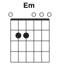
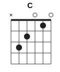
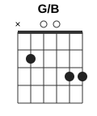
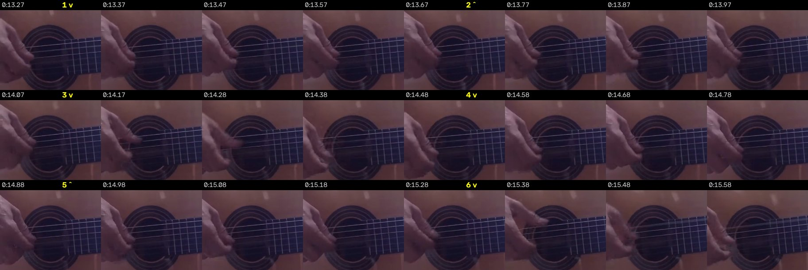

# Abuelito Fuego: разбор для гитары

Видео: классическая гитара крупным планом, каподастр, поёт один голос. 1:21.

Автоматический разбор (`README.md`) ошибся в главном: он посчитал песню в 4/4 и нашёл там лишние аккорды (A, Bm, D). Здесь всё пересчитано по чистой гитаре: голос отделён нейросетью Demucs, ноты сняты по каждому такту и сверены с кадрами.

## Коротко

| | |
|---|---|
| Каподастр | **3-й лад** |
| Аккорды | **Am, Em, Dm, C, G/B**. Звучат как Cm, Gm, Fm, E♭, B♭/D |
| Размер | **на шесть**: «раз-два-три-четыре-пять-шесть», один аккорд на такт |
| Бой | **↓ ↑ ↓ ↓ ↑ ↓**, удар на каждый счёт |
| Темп | ~150 счётов в минуту (такт 2,4 с) |
| Форма | две части по 8 тактов, каждая звучит дважды: сначала без голоса, потом с голосом |

## Аккорды

    

Лады считаются от каподастра. Все пять аккордов в первой позиции, баррэ нет.

| Аккорд | Лады (6→1) | Звучит как | Где |
|---|---|---|---|
| **Am** | `x02210` | Cm | основной, 6-ю не бьём |
| **Em** | `022000` | Gm | часть А |
| **Dm** | `xx0231` | Fm | часть Б, бьём от 4-й струны |
| **C** | `x32010` | E♭ | часть Б |
| **G/B** | `x20033` | B♭/D | часть Б, 6-ю не бьём |

**G/B** — это соль мажор с басом си. Средний палец на 5-й струне, 2-й лад; безымянный и мизинец на 2-й и 1-й струнах, 3-й лад; 4-я и 3-я открытые. Если неудобно, на первых порах подойдёт обычный G (`320003`). Звучит грубее, но в песню попадёт.

## Форма песни

Всего две части, и обе состоят из четырёх тактов, которые повторяются два раза.

```
Часть А:  | Am | Am | Em | Am |  ×2
Часть Б:  | Dm | C  | G/B| Am |  ×2
```

| Время | Что | Голос |
|---|---|---|
| 0:01 | А (8 тактов) | гитара одна |
| 0:20 | Б (8 тактов) | гитара одна |
| 0:40 | А | «Abuelito fuego…» ×2 |
| 0:59 | Б | «Por abrir el corazón…» ×2 |
| 1:16–1:21 | Am до конца | гитара одна |

## Бой

Каждый такт — шесть ударов, по одному на счёт. Играется пальцами, без медиатора.

```
Счёт:   1    2    3  │  4    5    6
Рука:   ↓    ↑    ↓  │  ↓    ↑    ↓
Сила:   >              >
        громко  тише │ средне
```

На слух: **РАЗ-два-три, ЧЕ-тыре-пять-шесть**.

- **1 ↓** — самый сильный удар в такте, по всем струнам аккорда.
- **2 ↑** — вверх по верхним струнам.
- **3 ↓** — лёгкий удар вниз, самый тихий в такте.
- После «3» рука **уходит вверх мимо струн**, чтобы снова ударить вниз на «4». Это хорошо видно на кадрах.
- **4 ↓ 5 ↑ 6 ↓** — то же самое, только ровнее, без сильного акцента. После «6» снова пустой подъём.

Получается не маятник «вниз-вверх», а повторяющаяся фигура из трёх ударов «вниз-вверх-вниз», и после неё пустой взмах. Новичкам это сначала непривычно: кажется, будто два «вниз» подряд. Так и есть.

Как разучить:
1. Заглушите струны левой рукой. Считайте вслух «раз-два-три, раз-два-три» и бейте ↓ ↑ ↓, затем рука вверх мимо струн. Метроном 90.
2. Добавьте акцент: «РАЗ» громче, «три» совсем тихо.
3. На одном Am сыграйте четыре такта, затем Am → Em → Am.
4. Часть Б отдельно: Dm → C → G/B → Am, по такту на аккорд. Сложнее всего переход C → G/B: безымянный уходит с 5-й струны на 2-ю, средний встаёт на 5-ю.
5. Поднимайте темп до 150.

## Текст с аккордами

Аккорд стоит над словом, на котором его нужно сменить. Слева время в ролике. Последнее слово строки («damos», «amor») поётся ещё на старом аккорде, Am приходит сразу после него, пока голос тянет.

```
— ВСТУПЛЕНИЕ, гитара (0:01–0:40) —
       Am    Am    Em    Am     Am    Am    Em    Am
0:01  |  …  |  …  |  …  |  …  |  …  |  …  |  …  |  …  |
       Dm    C     G/B   Am     Dm    C     G/B   Am
0:20  |  …  |  …  |  …  |  …  |  …  |  …  |  …  |  …  |

— ЧАСТЬ А, голос —
       Am                Am                     Em                       Am
0:40  Abuelito fuego,   las gracias te damos,  las gracias te damos  …(тянем)

       Am                Am                     Em                       Am
0:49  Abuelito fuego,   las gracias te damos,  las gracias te damos  …(тянем)

— ЧАСТЬ Б, голос —
            Dm                 C               G/B                  Am
0:59  Por  abrir el corazón,  a la sanación,  abrir el amor   …(тянем)

       Dm                  C               G/B                  Am
1:09  Abrir el corazón,   a la sanación,  abrir el amor   …(тянем)
       Am
1:18  (последние удары, пусть звенит)
```

Перевод: «Дедушка огонь, благодарим тебя. Чтобы открыть сердце исцелению, открыть любовь».

Слова распознаны автоматически (Whisper) по отделённому голосу. Первые три строки разборчивы. Четвёртая расшифровалась только с подсказкой, но по ритму и времени слов она совпадает с третьей до десятых долей секунды, поэтому скорее всего это повтор.

## Как проверял

| Что | Чем | Результат |
|---|---|---|
| Каподастр | звук + кадры | по звуку только на 3-м ладу все аккорды ложатся в открытые формы (90% времени против 34% у 5-го). На кадрах пальцы всю песню в первых трёх ладах от каподастра |
| Аккорды | спектр чистой гитары (Demucs), ноты и бас по тактам | Am-форма: до в басу, ми-бемоль громче ми (−12 и −17 дБ), значит минор. Em-форма: бас соль. Dm: фа, до, ля-бемоль. C: ми-бемоль, си-бемоль, соль. G/B: бас ре, си-бемоль, фа |
| Размер и темп | автокорреляция ударов по звуку и движения руки на видео | звук повторяется через 6 восьмых сильнее, чем через 4. Рука повторяет одно движение каждые 1,2 с (3 восьмые, корреляция 0,70). Аккорды меняются ровно раз в 2,4 с |
| Направление ударов | два признака: что звучит раньше, бас или верх; куда движется рука на видео | на «2» и «5» верхние струны опережают басовые на 15–20 мс, на «1» и «6» на 3 мс, на «3» и «4» на 9–11 мс. Чем больше опережение, тем вероятнее удар вверх. Оптический поток по руке даёт то же: вверх на «2» и «5», вниз на остальных |
| Сила ударов | громкость каждой восьмой, медиана по ~25 тактам | 1: 1,7; 2: 1,4; 3: 0,6; 4–6: около 1,0 |

Что осталось неточным:
- В G/B 1-я струна может звучать открытой (`x20030`): соль на ней слышна чуть сильнее, чем си-бемоль. На слух разница небольшая.
- На стыке Em → Am и G/B → Am иногда проскакивает бас соль на 6-й струне. Скорее всего, рука задевает её в ударе.
- Направление на «3» и «4» определено увереннее по видео, чем по звуку. Если удобнее, играйте «3» вверх: ↓ ↑ ↑ получается похоже.

## Покадровая сверка

**Правая рука, один такт 0:13,27–0:15,58** (кадр каждые 0,1 с). Подпись — время по звуку, видео отстаёт примерно на 0,13 с, это учтено. Жёлтым отмечены счёт и направление (v — вниз, ^ — вверх).



После «3» (0:14,17–0:14,38) и после «6» (0:15,38) пальцы поднимаются к басовым струнам, не задевая их. Это и есть пустой взмах перед ударом вниз на «4» и «1».

**Левая рука, пять аккордов** (верхний ряд — вступление, нижний — те же аккорды с голосом). Подпись — аккорд по звуку.


Каждый аккорд выглядит одинаково в обоих местах песни. У **C** один палец тянется к басовым струнам на 3-й лад (безымянный на 5-й струне). У **Em** два пальца на 2-м ладу у басовых струн. У **Dm** кисть собрана у тонких струн рядом с каподастром. У **G/B** широкая растяжка: палец на басу и два пальца на тонких струнах. Видео 720p: позицию и форму руки видно, отдельные струны под пальцами — не всегда, поэтому сами лады определены по звуку.

Гитара без голоса для игры вместе: [guitar.ogg](guitar.ogg); голос без гитары: [vocals.ogg](vocals.ogg).
