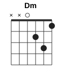
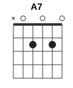
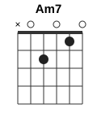
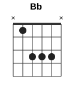
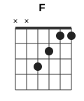
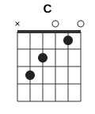
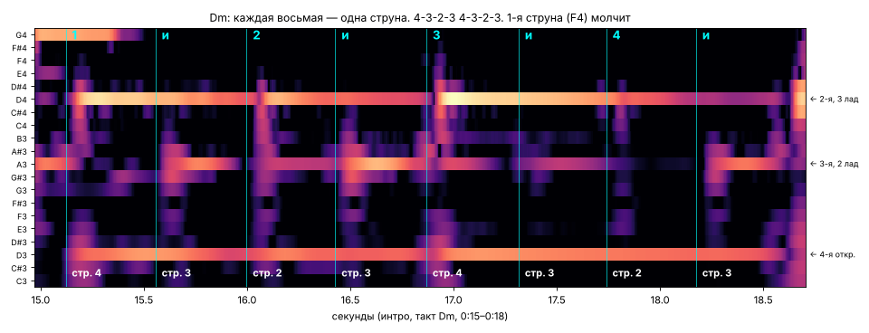
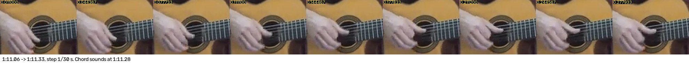

# He Yama Yo: перебор и бой

Видео: Jesús Cicuéndez, «He Yama Yo — Tutorial Guitarra-Tambor» (3:49, 360p). Аккорды и текст взяты из субтитров ролика, перебор и бой восстановлены по звуку и кадрам.

## Коротко

| | |
|---|---|
| Строй | стандартный, без каподастра |
| Аккорды | Dm, A7 в куплете; Am7, Bb, F, C в части «Wahi na ya na» |
| Размер | 4/4, в такте 8 восьмых |
| Темп | ~70 четвертей в минуту (восьмая ≈ 0,43 с), к концу чуть быстрее |
| Вступление 0:05–0:48 | **перебор**: бас + три ноты, 8 щипков на такт |
| С бубном 0:50–3:38 | **бой**: бас большим пальцем + удары указательным вниз |
| Гитара | классическая, нейлон, играет пальцами, без медиатора |

## Аккорды

     

| Аккорд | Лады (6→1) | Пальцы | Бас (большой палец) |
|---|---|---|---|
| **Dm** | `xx0231` | 3-я стр. — средний, 2-я — **мизинец**, 1-я — указательный | 4-я струна |
| **A7** | `x02020` | 4-я — средний, 2-я — безымянный | 5-я струна |
| **Am7** | `x02010` | 4-я — средний, 2-я — указательный | 5-я струна |
| **Bb** | `x1333x` | указательный на 5-й, безымянный кладёт мини-баррэ на 4-3-2-ю | 5-я струна |
| **F** | `xx3211` | малое баррэ указательным на 1-2-й | 4-я струна |
| **C** | `x32010` | обычный | 5-я струна |

Аппликатуры Dm, A7, Am7 и Bb — со схем в самом ролике (0:05–0:40). Dm он берёт с мизинцем на 2-й струне, так переход в A7 и Am7 короче. F и C в ролике без схем, здесь даны стандартные.

## Последовательность

Часть A, «Hey yama yo, wana he hey yo» (по такту на аккорд, строка ×2):

```
| Dm                 | A7                 | Dm |
  Hey yama yo,         Hey yama yo,
  wana he hey yo       wana he hey yo
```

Часть B, «Wahi na ya na, hey hey hey jo, wahi hey hey hey hey hey jo wahi»:

```
| Dm | Am7 | Bb | Am7 A7 | Bb | Dm |
```

Часть B': то же самое, только начало **F → C** вместо Dm → Am7:

```
| F | C | Bb | Am7 A7 | Bb | Dm |
```

| Время | Часть |
|---|---|
| 0:05–0:28 | A, гитара одна, перебор |
| 0:30–0:48 | B, перебор |
| 0:50–1:13 | A, вступает бубен, дальше бой |
| 1:13–1:28 | B |
| 1:30–1:48 | A |
| 1:50–2:08 | **B'** (F C) |
| 2:10–2:22 | A |
| 2:25–2:40 | B |
| 2:45–2:58 | A |
| 3:00–3:18 | **B'** (F C) |
| 3:20–3:38 | A, конец |

Границы частей сняты по субтитрам с шагом 5 секунд, плюс-минус пара секунд.

## Перебор (вступление, 0:05–0:48)

Кисть стоит над розеткой и не двигается, работают только пальцы. Большой (**p**) играет бас, указательный (**i**) 3-ю струну, средний (**m**) 2-ю. 1-я струна в переборе не звучит.

**Dm** (проверено по 4 чистым тактам из 6):

```
Счёт:    1   и   2   и   3   и   4   и
Струна:  4   3   2   3   4   3   2   3
Палец:   p   i   m   i   p   i   m   i
```



На каждую восьмую звучит одна струна: D (4-я открытая), A (3-я), D (2-я), A (3-я) — и по кругу. На «1» и «3» бас звучит громче остальных.

**A7, Am7, Bb, C** (бас на 5-й струне): та же идея, только бас начинает с 5-й, а дальше пальцы идут вверх по струнам.

```
Счёт:    1   и   2   и   3   и   4   и
Струна:  5   4   3   2   5   4   3   2
Палец:   p   p   i   m   p   p   i   m
```

Это видно в чистом такте A7 на 0:22–0:26: A, E, G, C#, A, E, G, C#. Для Bb и Am7 в интро тактов мало, и там он местами бьёт по аккорду целиком. Если неудобно, играйте на них схему Dm (5-3-2-3), просто начиная с баса на 5-й. На слух разница почти незаметна.

**F**: как Dm, бас на 4-й струне.

## Бой (с бубном, 0:50–3:38)

Как только вступает бубен, перебор уходит. Остаются бас большим пальцем и короткие удары **указательным вниз**: палец сгибается, а потом резко разгибается и ногтем проходит по 4–1-й струнам. Кисть при этом стоит на месте, это не бой всей рукой.



На полтакта (две доли) приходится такой рисунок:

```
Счёт:  1   е   и   а   2   е   и   а
Рука:  Б   ·   ·   ↓   б   ·   ↓   ·
```

- **Б** — бас большим пальцем, громко. Совпадает с ударом бубна.
- **↓** — указательный вниз по аккорду, звонко.
- **б** — лёгкий бас, можно пропустить.
- **·** — пауза, струны звенят.

На слух: **БУМ — — ЧА (бум) — ЧА —**, и вторая половина такта такая же. Удар на «а» первой доли идёт чуть раньше второй доли, отсюда «качающееся» ощущение. Так ложится в 3 из 5 проверенных тактов подряд, в остальных он иногда сдвигает второй удар на долю позже: это вариации, основа одна.

Бас по аккорду: Dm и F — 4-я струна, остальные — 5-я.

## Как разучить

1. Схема Dm без левой руки: открытые 4-3-2-3 пальцами p-i-m-i. Метроном 60, на каждый щелчок одна струна.
2. Добавьте Dm. Затем смену Dm → A7: бас переходит на 5-ю, пальцы идут 5-4-3-2.
3. Часть A целиком: | Dm | A7 | Dm | ×2, метроном 70 (восьмые по 140).
4. Отдельно бой: на заглушённых струнах «БУМ — — ЧА (бум) — ЧА —», бас большим, «ЧА» указательным вниз.
5. Бой на Dm, потом на Dm → A7, потом часть B. Играйте вместе с [guitar-drum.ogg](guitar-drum.ogg).

## Как проверял

| Что | Чем | Результат |
|---|---|---|
| Аккорды и аппликатура | субтитры и схемы в кадре 0:05–0:40 | Dm `xx0231`, A7 `x02020`, Am7 `x02010`, Bb `x1333x` |
| Строй, каподастр | высота нот по звуку | стандартный, каподастра нет |
| Длина такта | смена баса по всем долям вступления | ровно 8 восьмых на аккорд, восьмая 0,435 с |
| Струны в переборе | голос удалён (UVR MDX-Net), ноты распознаны basic-pitch, усреднены по тактам | Dm: 4-3-2-3 ×2; A7: 5-4-3-2 ×2 |
| Бой | сила ударов по полосам частот: бас, верх, бубен | бас на 1 и 3, яркие удары на «а» и «и» |
| Чем бьёт | кадры 1:07,6 и 1:11,1 с шагом 1/30 с | разгибается указательный, кисть стоит |

Что осталось неточным:
- Видео в 360p: пальцы правой руки видны пятном. Какая струна под каким пальцем, восстановлено по звуку, а p-i-m — это стандартная классическая расстановка под такие струны.
- На «1» и «3» перебора вместе с басом может звучать и 2-я струна (щипок p+m). По звуку это не отличить от обертона баса. Играйте как удобнее.
- Перебор на Bb и Am7 по записи определён хуже всего: тактов мало, и он их часто бьёт целиком.
- В бою голос убран нейросетью, но бубен остался. Его гул местами путает распознавание нот, поэтому рисунок боя дан по силе ударов, а не по отдельным нотам.

Гитара с бубном без голоса: [guitar-drum.ogg](guitar-drum.ogg).
